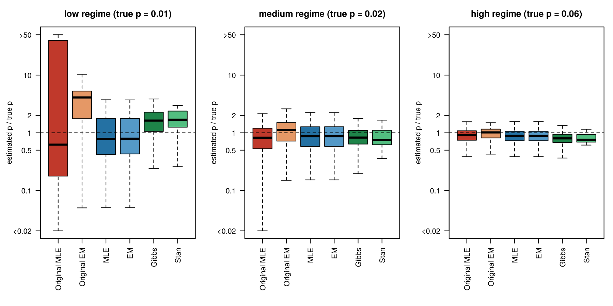
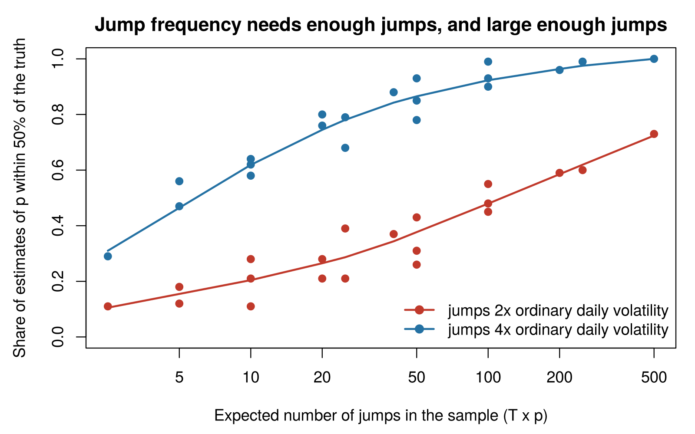
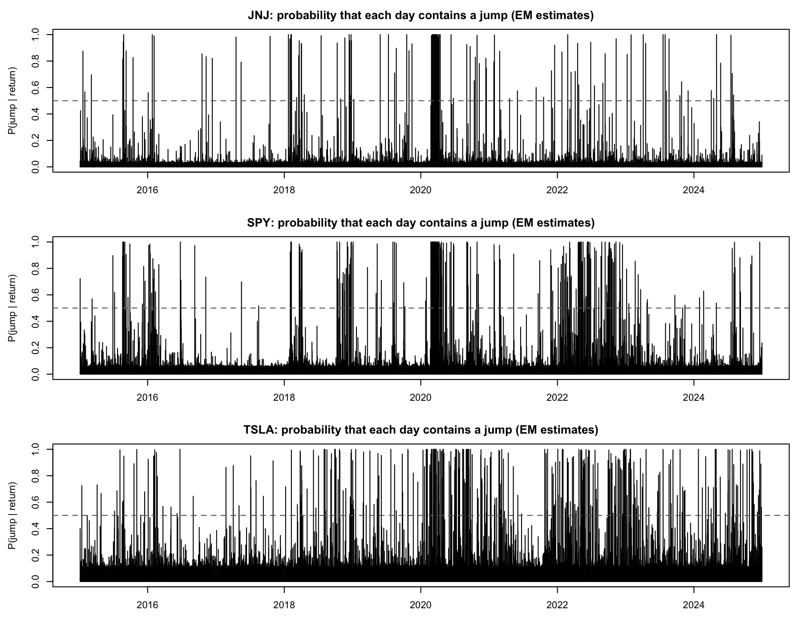

# Jump-diffusion estimation: when can rare market shocks be recovered from daily returns?

Stock returns are mostly ordinary days, punctuated by rare, sudden jumps. For risk management the jumps are what
matter: how often they happen and how large they are. This repository compares four ways of estimating them —
**maximum likelihood, the EM algorithm, a Gibbs sampler and Hamiltonian Monte Carlo (Stan)** — and asks a
practical question: *how much data, and how large a jump, does it take before any method can recover them, and
does the model hold up on real stocks?*

It started as a course project (Statistical Computing, University of Connecticut). This version corrects the
original implementation, adds tests, a Monte Carlo study, a prior-sensitivity analysis and a model check, and
is the foundation for ongoing work on measuring stock-specific jump risk (see [Roadmap](#roadmap)).

## Findings at a glance

All numbers come from the scripts in this repository (200 simulated datasets of 2000 days per regime; see
[Results](#results)).

- **With enough jumps, all four methods work.** In the medium and high regimes (about 40 and 120 jumps per
  dataset), MLE and EM recover the jump frequency to within about 10–15% in the median. The Bayesian estimates
  sit 15–25% low, an effect of the prior on the jump variance (below).
- **With rare jumps, no method can recover them, and that is a property of the data.** With about 20 jumps in
  2000 days, the MLE's typical error in the jump frequency is 61% of the true value, and its jump-size estimate
  collapses to zero in 43% of datasets. The Bayesian estimates never collapse, but they are pulled toward the
  prior (median 1.6 times the truth). On the report's dataset the bootstrap standard error of the jump frequency
  is 33 times the estimate.
- **How many jumps are enough depends on their size.** When jumps are 4 times the ordinary daily volatility,
  about 20 jumps in the sample put 80% of estimates within ±50% of the truth. When they are 2 times the daily
  volatility, even 200 jumps manage only 59%.
- **The prior is a trade-off, and it is reported as one.** The prior on the jump variance that prevents the
  collapse with rare jumps biases the jump size and frequency downward when jumps are frequent: the Gibbs 95%
  intervals cover the true jump frequency in 98%, 94% and 90% of datasets in the low, medium and high regimes.
  In the low regime the prior on the jump frequency matters: the posterior median is 0.014, 0.026 and 0.041
  (truth 0.01) under priors with mean 0.02, 0.1 and a flat prior. Under the flat prior the sampler mixes slowly,
  occasionally visiting a "fake jump" solution with a much larger frequency, so its upper tail is unstable
  even with four long chains.
- **The implementations check each other.** MLE and EM reach the same maximum of the likelihood in 99.7% of
  datasets; Gibbs and Stan, with identical priors, give the same posterior. Stan reported divergent transitions
  in one of 75 fits, a low-regime dataset, which is itself a sign of weak identification.
- **On real stocks the model's key assumption fails, and a test shows it.** If jumps are independent, the days
  classified as jumps should be spread evenly over time. A chi-square test of this rejects in only 1.5–3% of
  simulated datasets, where the model is true, but rejects for JNJ, SPY and TSLA (p < 0.001): SPY has 53 "jump
  days" in 2020 and 63 in 2022, but 2 in 2017. On real data the jump component absorbs volatility clustering,
  so its estimates describe fat tails rather than the frequency of genuine jumps.

## Model

Daily log-returns follow a discrete-time jump-diffusion:

$$R_t = \mu + \sigma\varepsilon_t + Y_t Z_t,\qquad \varepsilon_t\sim N(0,1),\quad Y_t\sim \text{Bernoulli}(p),\quad Z_t\sim N(\mu_J,\sigma_J^2).$$

On ordinary days returns are normal; on a fraction $p$ of days a jump of random size $Z_t$ is added.
Marginally each return is a two-component normal mixture whose jump component has variance
$\sigma^2+\sigma_J^2$. Three regimes are simulated, $T = 2000$ days each:

| Regime | $\sigma$ | $p$ | $\mu_J$ | $\sigma_J$ | Expected jumps |
|---|---|---|---|---|---|
| Low | 0.007 | 0.01 | −0.015 | 0.01 | 20 |
| Medium | 0.010 | 0.02 | −0.030 | 0.02 | 40 |
| High | 0.020 | 0.06 | −0.060 | 0.04 | 120 |

## Methods

| Method | How it works | Code |
|---|---|---|
| Maximum likelihood | BFGS on the mixture likelihood, rescaled data, 8 starting points | [`R/mle.R`](R/mle.R) |
| EM algorithm | Treats jump days *and jump sizes* as missing data; closed-form updates; likelihood never decreases | [`R/em.R`](R/em.R) |
| Gibbs sampler | Samples jump days and jump sizes, then each parameter from its exact conditional; 2 chains, R-hat | [`R/gibbs.R`](R/gibbs.R) |
| Stan (NUTS) | Marginal mixture likelihood, priors identical to the Gibbs sampler; divergence and R-hat checks | [`R/stan.R`](R/stan.R), [`stan/`](stan/jump_diffusion.stan) |
| Bootstrap | Standard errors for MLE and EM by resampling days | [`R/bootstrap.R`](R/bootstrap.R) |
| Independence test | Chi-square test that days classified as jumps are spread evenly over time | [`R/diagnostics.R`](R/diagnostics.R) |

Priors (Gibbs and Stan): $p\sim\text{Beta}(1,9)$, $\mu,\mu_J\sim N(0,0.05^2)$,
$\sigma^2,\sigma_J^2\sim\text{Inv-Gamma}(2,\,2\times10^{-4})$. Full derivations are in the
[report](report/Project.pdf) ([R Markdown source](report/Project.Rmd)).

## Results



*Estimated / true jump frequency $p$ over 200 simulated datasets per regime (Stan: 25), log scale, 1 = correct.
"Original" are the estimators as first submitted for the course; values beyond the axis are drawn at its edge.*



*Share of EM estimates of the jump frequency within ±50% of the truth, against the expected number of jumps in
the sample, for jumps 2 and 4 times the ordinary daily volatility (100 datasets per point).*



*Probability that each day contains a jump, at the EM estimates. Under the model these days would be spread
evenly over time; they cluster in turbulent periods such as 2020 and 2022.*

Further outputs, all produced by the scripts below: the four methods on one dataset per regime
(`results/single_dataset.csv`), bootstrap standard errors (`results/bootstrap_se.csv`), prior sensitivity
(`results/prior_sensitivity.csv`), Monte Carlo summary (`results/monte_carlo_summary.csv`), how many jumps
are needed (`figures/jumps_needed.png`), the independence test on simulated and real data
(`results/independence_test_*.csv`) and the daily jump probabilities of the three stocks
(`figures/real_data_jump_prob.png`).

## What I corrected in the original course project

Reviewing my own course submission, I found and fixed four problems — a useful reminder that a method can look
fine on one dataset and still be wrong:

1. **The EM algorithm was not the jump-diffusion EM.** It fitted an unconstrained two-group normal mixture and
   derived the jump variance afterwards. The corrected EM augments the jump size and respects the model's
   variance constraint; every iteration provably increases the likelihood (tested).
2. **The Gibbs sampler had the same issue,** and its written full conditionals did not match its code.
   The corrected sampler augments the jump size, so every conditional is exact.
3. **The MLE "failure" in the low regime was an optimiser failure.** A single unscaled starting point gave an
   estimated jump frequency of 0.62 against a true 0.01. Rescaling and multiple starts fix it.
4. **Stan was switched off when the report was knitted,** and its column in the comparison table was typed in
   from separate runs. It now runs inside the report, with the same priors as the Gibbs sampler, so every number
   in the report is computed by the code.

## Repository structure

```
R/                       one file per component (load everything with source("R/load.R"))
  simulate.R             simulator and the three regimes
  likelihood.R           mixture log-likelihood and daily jump probabilities
  mle.R  em.R  gibbs.R  stan.R      the four estimators
  bootstrap.R            bootstrap standard errors
  diagnostics.R          independence test for the jump days
stan/                    Stan model
tests/                   correctness checks: density integrates to 1, EM never decreases the likelihood,
                         EM = MLE, large-sample recovery, Gibbs and Stan agree, independence test has the right size
analysis/
  01_single_dataset.R    the four methods on the report's datasets, original vs corrected estimators
  02_bootstrap.R         bootstrap standard errors (MLE, EM)
  03_prior_sensitivity.R low regime under three priors for the jump frequency
  04_monte_carlo.R       repeated simulation: bias, error, collapse of the jump size, interval coverage
  05_jumps_needed.R      accuracy against the expected number of jumps and the jump size
  06_independence_test.R does the model check work when the model is true?
  07_real_data.R         JNJ, SPY, TSLA 2015-2024: estimates and the model check
  08_summarise.R         Monte Carlo summary table and figure
report/                  the course report (R Markdown and PDF), with the corrections above
results/  figures/       outputs
```

## Reproduce

Requires R (>= 4.2) with `rstan`, `testthat` and `rmarkdown`; `quantmod` for the real data.

```bash
Rscript run_all.R        # tests and every analysis, in order, with a log in results/run_all.log
Rscript -e 'rmarkdown::render("report/Project.Rmd")'     # the report (self-contained)
```

Each script can also be run on its own from the repository root; the usage line at the top of each file gives
its arguments (number of datasets, cores). Every simulated dataset has its own seed, so results do not depend on
the number of cores.

## Roadmap

This repository is the first step of a larger plan.

1. **Foundation (this repository).** Reliable estimation of jump frequency and size from a single return
   series, and an honest account of when the data cannot identify them.
2. **Volatility that changes over time.** The model check above shows that on real stocks, jumps cannot be
   measured without accounting for calm and turbulent periods. Next: jumps measured relative to time-varying
   volatility (GARCH or stochastic volatility), and possibly self-exciting jumps.
3. **Separating market shocks from stock-specific shocks.** A stock's big moves come partly from the market and
   partly from events specific to the company. Using what the market itself reveals to tell the two apart is
   the focus of my current work (in progress, not public).
4. **Risk in time.** Turning the estimates into simple measures a risk manager can use: how often a stock or
   fund takes its own hits, how large they are, and what that means over an investor's holding horizon.
5. **Validation on real data.** Out-of-sample tests across many stocks and funds.

## Author

Kapil Chandak — MS Statistics, University of Connecticut · kapil.chandak@uconn.edu
